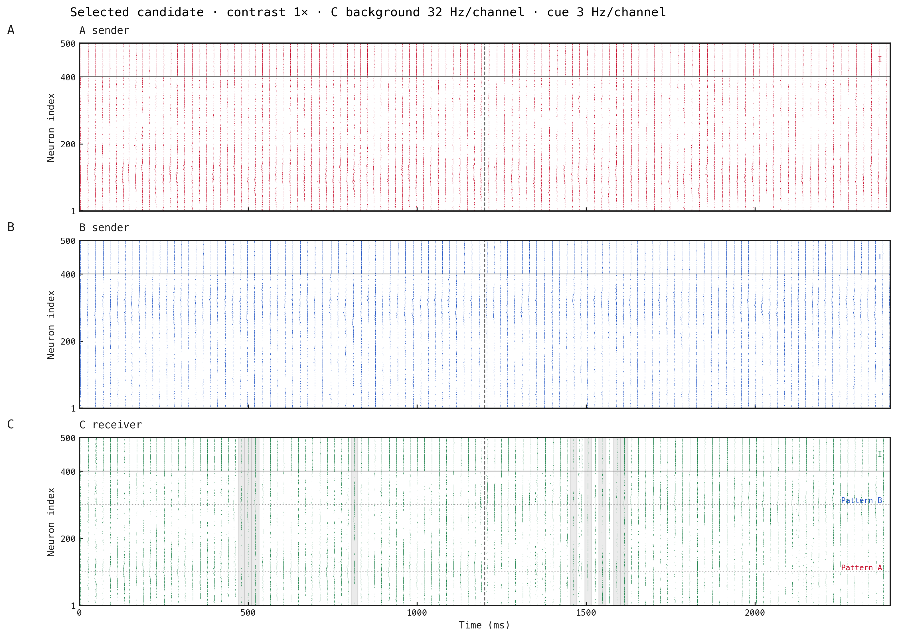

# Best measured combination

Contrast 1× (unchanged original spatial profile), C independent background 32 Hz/channel, cue 3 Hz/channel; original fixed weights and seed 185. This exact combination was already simulated as background-32, so presentation requires no new simulation.

Selection maximises the poorer of the two S values, then mean S, with mean F as an accuracy-tie breaker. The candidate independently has the highest S in both periods and the lowest A F. Lower B F alone is attainable by sacrificing accuracy and speed.

| Attend | S | F | Latency (cycles) | Baseline S | Baseline F |
|---|---:|---:|---:|---:|---:|
| A | 0.900 | 0.103 | 3 | 0.846 | 0.105 |
| B | 0.872 | 0.184 | 1 | 0.842 | 0.216 |

A red, B blue, C green; inhibitory neurons are above excitatory neurons. The dashed line at 1200 ms marks the cue switch. Pale grey intervals in C mark unattended-dominant complete cycles inside the settled metric windows; they are retained rather than hidden. The first A latency is acquisition; B is switching from A.

The tiny A F reduction is denominator-only (4 changes/39 pairs versus 4/38); B has 7/38 versus 8/37, with different settled-window initial state. These are modest one-seed changes, not elimination of flicker. Formal exp172 settings are unchanged.

Validation/rendering: 0.52 s. New simulations: 0.
