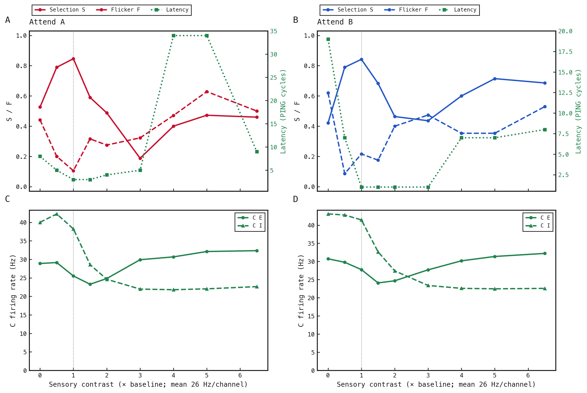
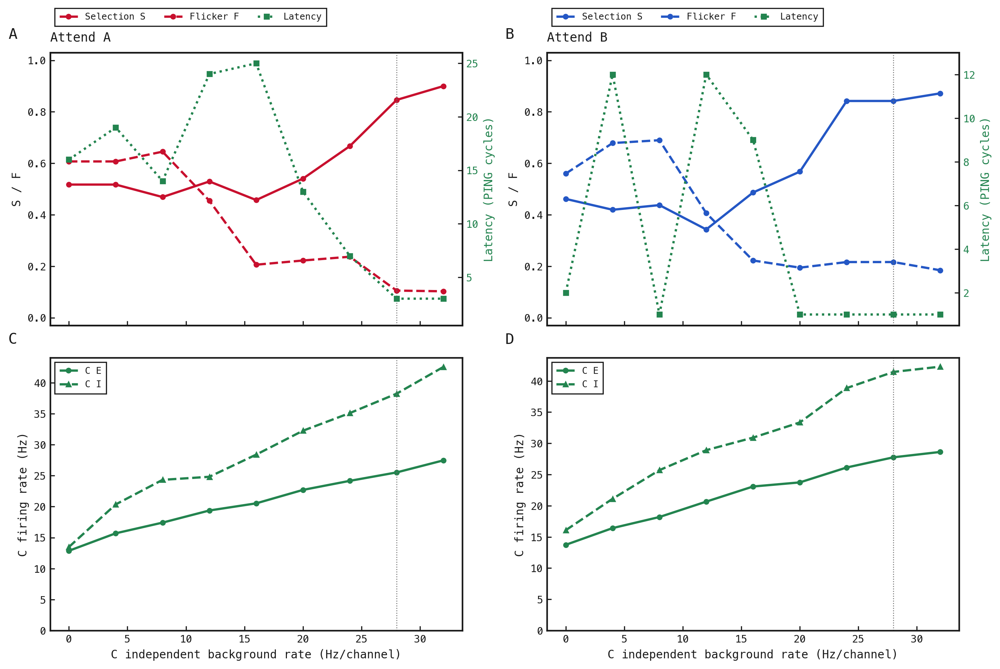

# exp172 contrast and C-background sweeps

1. Two separate sweeps; cue 3 Hz/channel, fixed seed 185 and exact exp172-r132 representative-trial weights. Baseline is freshly rerun and matches all six original spike arrays exactly.
2. Contrast c rescales the spatial modulation about its fixed mean: r_c(x) = 26 + c × [r_1(x) − 26] Hz/channel, where x is channel position and r_1 is the original spatial rate profile. Both A and B change together. c=0 removes spatial contrast; c=1 is baseline. Width and expected mean stay fixed, while the flat component becomes 26 − 4c. At c=6.5 that component reaches zero.
3. C background changes only the independent X_C input rate. All four sender spike arrays are checked identical across that sweep. Synaptic weights are exactly identical in every run.
4. Metrics use the corrected trough-to-trough decoder. S/F and C firing rates use the same settled A/B windows; latency retains the three-consecutive-cycle criterion from cue onset. Missing F or latency stays missing rather than becoming zero. Raw cycle counts and resolution are in metrics.csv.
5. The green right axis is latency in cycles; coloured left-axis lines are S (solid) and F (dashed). Lower panels show C E/I rates. Vertical dotted lines identify the current parameters. Inputs use paired random-number streams, not identical realised spike counts when rates change. No seed averaging or uncertainty intervals.

| Sweep | Control | Attend | S | F | Latency (cycles) | C E (Hz) | C I (Hz) | Resolved/total |
|---|---:|---|---:|---:|---:|---:|---:|---:|
| contrast | 0 | A | 0.526 | 0.441 | 8 | 28.89 | 40.00 | 36/38 |
| contrast | 0 | B | 0.421 | 0.621 | 19 | 30.74 | 43.11 | 33/38 |
| contrast | 0.5 | A | 0.789 | 0.2 | 5 | 29.14 | 42.27 | 37/38 |
| contrast | 0.5 | B | 0.789 | 0.0857 | 7 | 29.78 | 42.80 | 37/38 |
| contrast | 1 | A | 0.846 | 0.105 | 3 | 25.51 | 38.22 | 39/39 |
| contrast | 1 | B | 0.842 | 0.216 | 1 | 27.76 | 41.45 | 38/38 |
| contrast | 1.5 | A | 0.59 | 0.316 | 3 | 23.28 | 28.58 | 39/39 |
| contrast | 1.5 | B | 0.683 | 0.175 | 1 | 24.09 | 32.66 | 41/41 |
| contrast | 2 | A | 0.488 | 0.275 | 4 | 24.81 | 24.61 | 41/41 |
| contrast | 2 | B | 0.463 | 0.4 | 1 | 24.68 | 27.41 | 41/41 |
| contrast | 3 | A | 0.188 | 0.323 | 5 | 29.90 | 21.96 | 32/32 |
| contrast | 3 | B | 0.436 | 0.474 | 1 | 27.70 | 23.39 | 39/39 |
| contrast | 4 | A | 0.4 | 0.471 | 34 | 30.67 | 21.80 | 35/35 |
| contrast | 4 | B | 0.6 | 0.353 | 7 | 30.18 | 22.60 | 35/35 |
| contrast | 5 | A | 0.472 | 0.629 | 34 | 32.12 | 22.04 | 36/36 |
| contrast | 5 | B | 0.714 | 0.353 | 7 | 31.38 | 22.47 | 35/35 |
| contrast | 6.5 | A | 0.459 | 0.5 | 9 | 32.35 | 22.64 | 37/37 |
| contrast | 6.5 | B | 0.686 | 0.529 | 8 | 32.22 | 22.59 | 35/35 |
| background | 0 | A | 0.517 | 0.607 | 16 | 12.87 | 13.48 | 29/29 |
| background | 0 | B | 0.462 | 0.56 | 2 | 13.74 | 16.08 | 26/26 |
| background | 4 | A | 0.517 | 0.607 | 19 | 15.69 | 20.35 | 29/29 |
| background | 4 | B | 0.419 | 0.679 | 12 | 16.42 | 21.12 | 30/31 |
| background | 8 | A | 0.469 | 0.645 | 14 | 17.41 | 24.32 | 32/32 |
| background | 8 | B | 0.438 | 0.69 | 1 | 18.19 | 25.71 | 31/32 |
| background | 12 | A | 0.529 | 0.455 | 24 | 19.37 | 24.81 | 34/34 |
| background | 12 | B | 0.343 | 0.406 | 12 | 20.66 | 28.91 | 34/35 |
| background | 16 | A | 0.457 | 0.206 | 25 | 20.52 | 28.39 | 35/35 |
| background | 16 | B | 0.486 | 0.222 | 9 | 23.08 | 30.92 | 37/37 |
| background | 20 | A | 0.541 | 0.222 | 13 | 22.69 | 32.25 | 37/37 |
| background | 20 | B | 0.568 | 0.194 | 1 | 23.74 | 33.35 | 37/37 |
| background | 24 | A | 0.667 | 0.237 | 7 | 24.16 | 35.09 | 39/39 |
| background | 24 | B | 0.842 | 0.216 | 1 | 26.13 | 38.86 | 38/38 |
| background | 28 | A | 0.846 | 0.105 | 3 | 25.51 | 38.22 | 39/39 |
| background | 28 | B | 0.842 | 0.216 | 1 | 27.76 | 41.45 | 38/38 |
| background | 32 | A | 0.9 | 0.103 | 3 | 27.46 | 42.54 | 40/40 |
| background | 32 | B | 0.872 | 0.184 | 1 | 28.62 | 42.29 | 39/39 |

17 fresh simulations. Summed simulation time 231.07 s; compute wall time 250.25 s; analysis/rendering 1.07 s.

These measurements are a first screen on one tuned seed. Low F alone can mean stable incorrect selection or insufficient receiver activity. No settings have been copied into the formal experiment.

## Interpretation

1. No non-baseline contrast value improves S, F and latency simultaneously in both attention periods. Increased contrast generally weakens attended dominance; a lower F in one period can accompany worse selection or slower acquisition.
2. Reducing C background below 28 Hz/channel does not improve the full set of objectives. At 24 Hz/channel the B metrics equal baseline but A worsens; stronger reductions substantially weaken selection.
3. Raising C background from 28 to 32 Hz/channel is the best tested direction: A S 0.846→0.900 and F 0.105→0.103; B S 0.842→0.872 and F 0.216→0.184. Acquisition/switch latency stays at 3/1 cycles. C E firing rises from 25.5/27.8 to 27.5/28.6 Hz in A/B periods, so this is not silence. All retained cycles at 32 are resolved. The tiny A F decrease is denominator-only: both cases have four changes, over 38 versus 39 eligible pairs. B has eight changes over 37 pairs at baseline versus seven over 38 at 32, but the 32-Hz settled window starts in the wrong state. These short-window counts are not evidence of a reliable reduction in event frequency.
4. No tested condition has zero F in both periods. Continuous background reduction changes C’s operating regime; a brief event-specific background interruption is not equivalent to reducing the drive throughout the trial. These plots identify candidate settings, not an isolated mechanism or a validated optimum.
