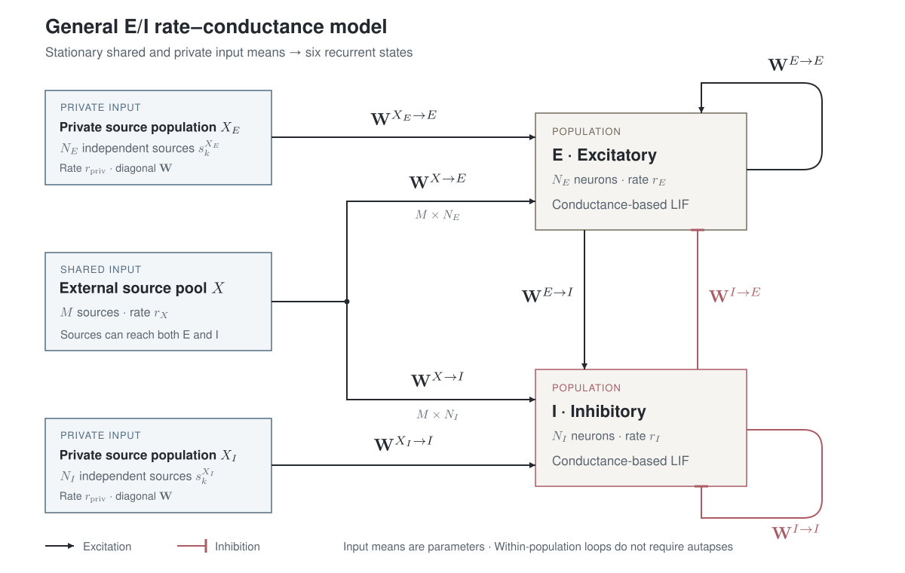

import EquationBox from './components/EquationBox.astro';

<figure>

<figcaption>
Figure 1. Dark arrows denote excitation; rose bars denote inhibition.
$X$ is shared input; $X_E,X_I$ provide one private source per neuron.
Weight superscripts give source → target. External input enters through stationary
mean conductances, not additional states. Population loops do not require autapses.
</figcaption>
</figure>

## The Model

Shared and private sources have constant rates and enter through stationary mean
conductances. Their filtering transients and covariance are omitted.

### States

<EquationBox label="State vector: six dynamical variables">

$$
x=\left(r_E,r_I,g_e^E,g_e^I,g_i^E,g_i^I\right)^{\mathsf T}.
$$

</EquationBox>

Six states: two population rates and four recurrent conductances.

### Rates

<EquationBox label="Population rates: two dynamical equations">

$$
\tau_{r,E}\dot r_E=-r_E+\Phi_E(I_E).
\tag{1}
$$

$$
\tau_{r,I}\dot r_I=-r_I+\Phi_I(I_I).
\tag{2}
$$

</EquationBox>

$r_E,r_I$ are firing rates; $\tau_{r,E},\tau_{r,I}>0$ are relaxation times.
$\Phi_E,\Phi_I$ are the stationary noisy-LIF gains in
[Equation 15](#derivation-firing-gain); $I_E,I_I$ are defined in
[Equations 9–10](#model-current).

### Recurrent conductances

<EquationBox label="Recurrent conductances: four dynamical equations">

$$
\dot g_e^E=-\frac{g_e^E}{\tau_{E\to E}}
+\frac{r_E}{N_E}\sum_{j,k}\mathbf W^{E\to E}_{jk}.
\tag{3}
$$

$$
\dot g_e^I=-\frac{g_e^I}{\tau_{E\to I}}
+\frac{r_E}{N_I}\sum_{j,k}\mathbf W^{E\to I}_{jk}.
\tag{4}
$$

$$
\dot g_i^E=-\frac{g_i^E}{\tau_{I\to E}}
+\frac{r_I}{N_E}\sum_{j,k}\mathbf W^{I\to E}_{jk}.
\tag{5}
$$

$$
\dot g_i^I=-\frac{g_i^I}{\tau_{I\to I}}
+\frac{r_I}{N_I}\sum_{j,k}\mathbf W^{I\to I}_{jk}.
\tag{6}
$$

</EquationBox>

$g_e^Q,g_i^Q$ are mean excitatory and inhibitory conductances into population
$Q\in\{E,I\}$. For pathway $P\to Q$, $j$ indexes $N_P$ sources and $k$ indexes
$N_Q$ targets. Each $\mathbf W_{jk}^{P\to Q}\ge0$ is a conductance jump per
spike; absent connections have zero weight. Dividing by target size $N_Q$
averages incoming drive, assuming source rate $r_P$ is homogeneous.
$\tau_{P\to Q}>0$ is the synaptic decay time.

### External input, effective currents and state count

<EquationBox label="Stationary shared and private input, effective currents and six-state count">

**External input**

$$
g_{\mathrm{ext}}^E=\frac{\tau_{\mathrm{AMPA},X}r_X}{N_E}\sum_{a,k}\mathbf W^{X\to E}_{ak}+\frac{\tau_{\mathrm{AMPA},\mathrm{priv}}r_{\mathrm{priv}}}{N_E}\sum_k\mathbf W^{X_E\to E}_{kk}.
\tag{7}
$$

$$
g_{\mathrm{ext}}^I=\frac{\tau_{\mathrm{AMPA},X}r_X}{N_I}\sum_{a,k}\mathbf W^{X\to I}_{ak}+\frac{\tau_{\mathrm{AMPA},\mathrm{priv}}r_{\mathrm{priv}}}{N_I}\sum_k\mathbf W^{X_I\to I}_{kk}.
\tag{8}
$$

**Effective currents**

$$
I_E=I_{\mathrm{ext},E}+\Delta V_{\mathrm{exc},E}(g_e^E+g_{\mathrm{ext}}^E)-\Delta V_{\mathrm{inh},E}g_i^E.
\tag{9}
$$

$$
I_I=I_{\mathrm{ext},I}+\Delta V_{\mathrm{exc},I}(g_e^I+g_{\mathrm{ext}}^I)-\Delta V_{\mathrm{inh},I}g_i^I.
\tag{10}
$$

</EquationBox>

All $M$ shared sources have rate $r_X$; $a$ indexes sources and $k$ targets.
Dividing each weight sum by target population size gives mean incoming weight.
$\tau_{\mathrm{AMPA},X}>0$ is the conductance decay time.

Private populations $X_E,X_I$ provide one independent source per neuron,
all at rate $r_{\mathrm{priv}}$, which may differ from $r_X$.
Their diagonal matrices connect source $k$ only to target $k$; the sums average
these weights over targets. $\tau_{\mathrm{AMPA},\mathrm{priv}}>0$ is the decay time.

$I_{\mathrm{ext},E},I_{\mathrm{ext},I}$ are applied currents. Fixed driving forces are
$\Delta V_{\mathrm{exc},Q}=E_e-E_{L,Q}$ and
$\Delta V_{\mathrm{inh},Q}=E_{L,Q}-E_i$, where $E_e,E_i$ are synaptic reversal
potentials and $E_{L,Q}$ is the leak reversal potential (resting voltage without other input).

With $\mathbf W^{E\to E}=\mathbf W^{I\to I}=0$ and
$g_e^E(0)=g_i^I(0)=0$, both self-conductances remain zero. The model then has
four states: $(r_E,r_I,g_e^I,g_i^E)$.

Units: ms for time $t$, spikes/neuron/ms for rates, µS for conductances and
weights, mV for voltages, and nA for currents. A dot denotes $d/dt$.

## Derivation

### From spikes to mean conductances

For a pathway from population $P$ to $Q$, each source spike adds conductance to
target neuron $k$:

$$
\dot g_{P\to Q,k}
=-\frac{g_{P\to Q,k}}{\tau_{P\to Q}}
+\sum_j\mathbf W^{P\to Q}_{jk}s_j^P(t).
\tag{11}
$$

Here $g_{P\to Q,k}$ is conductance, $\tau_{P\to Q}$ its decay time,
$s_j^P(t)$ source neuron $j$'s spike train, and $\mathbf W^{P\to Q}_{jk}$ the
conductance jump per spike. A dot denotes a time derivative.

Taking expectations, assuming a common source rate $r_P(t)$, and averaging over
the $N_Q$ targets gives

$$
\dot g_{P\to Q}
=-\frac{g_{P\to Q}}{\tau_{P\to Q}}
+\frac{r_P}{N_Q}\sum_{j,k}\mathbf W^{P\to Q}_{jk},
\tag{12}
$$

where $g_{P\to Q}$ is population-average expected conductance. Expectation is
exact for fixed weights; homogeneous source rates are an approximation.

External conductances follow the same equation, with constant shared rate $r_X$
and private rate $r_{\mathrm{priv}}$. Setting their derivatives to zero gives
[Equations 7–8](#model-external-input) after adding shared and private input. This eliminates four external states when their initial
means are stationary. Changing rates or nonstationary initial means require
restoring the input filters; instantaneous stationary substitution would be an
additional approximation. Input covariance is omitted throughout.

### From conductances to effective currents

A conductance $g$ with reversal potential $E_{\mathrm{rev}}$ produces current

$$
I_{\mathrm{syn}}=g(E_{\mathrm{rev}}-V_m),
\tag{13}
$$

where $V_m$ is membrane voltage. Approximate the driving force at the leak reversal
potential $E_{L,Q}$ of population $Q$, defining
$\Delta V_{\mathrm{exc},Q}=E_e-E_{L,Q}$ and
$\Delta V_{\mathrm{inh},Q}=E_{L,Q}-E_i$.
Here $E_e,E_i$ are excitatory and inhibitory reversal potentials.

Adding recurrent, shared and private contributions gives

$$
I_Q=I_{\mathrm{ext},Q}+\Delta V_{\mathrm{exc},Q}(g_e^Q+g_{\mathrm{ext}}^Q)-\Delta V_{\mathrm{inh},Q}g_i^Q.
\tag{14}
$$

Here $I_{\mathrm{ext},Q}$ is applied current; $g_e^Q,g_i^Q$ are recurrent
conductances; and $g_{\mathrm{ext}}^Q$ is total stationary external excitatory
conductance, combining shared and private input.

Fixing the driving forces removes voltage dependence, omitting shunting and
conductance-dependent membrane time constants.

### From effective currents to firing rates

For fixed current $I_Q$, approximate unresolved fluctuations by Gaussian white
noise. The stationary firing rate is the inverse of the mean time to reach
threshold plus the refractory period. The Siegert formula\[[1](#ref-1)\] gives

$$
\Phi_Q(I_Q)=\left[\tau_{\mathrm{ref},Q}+\tau_{m,Q}\sqrt{\pi}\int_{a_Q}^{b_Q}e^{u^2}\bigl(1+\operatorname{erf}(u)\bigr)\,du\right]^{-1},
\tag{15}
$$

with

$$
\mu_{V,Q}=E_{L,Q}+\frac{I_Q}{g_{L,Q}},\qquad a_Q=\frac{V_{\mathrm{reset},Q}-\mu_{V,Q}}{\sigma_{V,Q}},\qquad b_Q=\frac{V_{\mathrm{th},Q}-\mu_{V,Q}}{\sigma_{V,Q}}.
\tag{16}
$$

Here $g_{L,Q}$ is leak conductance, $\tau_{m,Q}=C_{m,Q}/g_{L,Q}$ is the membrane
time constant, and $C_{m,Q}$ is capacitance. The voltages
$V_{\mathrm{reset},Q},V_{\mathrm{th},Q}$ specify reset and threshold;
$\tau_{\mathrm{ref},Q}$ is the refractory period. The fixed parameter
$\sigma_{V,Q}>0$ sets the voltage-noise scale; $u$ is dimensionless and
$\operatorname{erf}$ is the error function.

To give the population a finite response time, let its rate relax toward this
stationary gain:

$$
\tau_{r,Q}\dot r_Q=-r_Q+\Phi_Q(I_Q),
\tag{17}
$$

where $r_Q$ is firing rate and $\tau_{r,Q}>0$ is the relaxation time.
This relaxation law is a closure assumption; the noise scale is prescribed
rather than derived from network fluctuations.

### Gain slope

For Jacobian calculations, differentiate [Equation 15](#derivation-firing-gain)
with respect to current, holding the noise scale fixed. Define

$$
h(u)=e^{u^2}\bigl(1+\operatorname{erf}(u)\bigr).
\tag{18}
$$

The Leibniz rule gives

$$
\Phi_Q'(I_Q)=\frac{\tau_{m,Q}\sqrt{\pi}}{g_{L,Q}\sigma_{V,Q}}\Phi_Q(I_Q)^2\left[h(b_Q)-h(a_Q)\right].
\tag{19}
$$

Here $\Phi_Q'$ is the gain's current derivative; the remaining terms are
[defined above](#derivation-gain-limits).

### Four-state reductions

Zero E→E and I→I weights with zero initial self-conductances give the four
states $(r_E,r_I,g_e^I,g_i^E)$ directly. Nonzero self-coupling also permits
four states when outgoing E pathways share a decay time, outgoing I pathways
share a decay time, and initial mean conductances satisfy

$$
g_e^E=\frac{N_I\sum_{j,k}\mathbf W^{E\to E}_{jk}}{N_E\sum_{j,k}\mathbf W^{E\to I}_{jk}}g_e^I,
\tag{20}
$$

$$
g_i^I=\frac{N_E\sum_{j,k}\mathbf W^{I\to I}_{jk}}{N_I\sum_{j,k}\mathbf W^{I\to E}_{jk}}g_i^E.
\tag{21}
$$

The cross-pathway sums must be nonzero. Subtracting each reconstructed
conductance from its full filter equation leaves a difference that decays
exponentially; it remains zero when initially zero. Arbitrary initial
differences or unequal outgoing decay times require the additional states.
These identities apply to population means, not individual neuronal
conductances. External input remains parameterised as above.

## Stability Analysis

### Equilibrium

Hold source rates, weights and applied currents fixed. An equilibrium $x^*$
satisfies $F(x^*)=0$, where $\dot x=F(x)$ denotes the six-state model. Setting
each recurrent conductance derivative to zero gives

$$
(g_{P\to Q})^*=\frac{\tau_{P\to Q}r_P^*}{N_Q}\sum_{j,k}\mathbf W^{P\to Q}_{jk}.
\tag{22}
$$

Substitute these conductances and the stationary external inputs into the
current definitions, then solve the two rate conditions

$$
r_Q^*=\Phi_Q(I_Q^*),\qquad Q\in\{E,I\}.
\tag{23}
$$

A star denotes equilibrium. Here $g_{E\to Q}=g_e^Q$ and
$g_{I\to Q}=g_i^Q$. Multiple equilibria may exist; analyse each separately.

### Analytical Jacobian

For a small perturbation $\delta x=x-x^*$, the first-order dynamics are

$$
\delta\dot x\approx J_{\mathrm{flow}}\delta x,\qquad J_{\mathrm{flow}}=\left.\frac{\partial F}{\partial x}\right|_{x=x^*}.
\tag{24}
$$

To keep the matrix readable, define the excitatory and inhibitory rate
sensitivities for target population $Q$:

$$
A_Q=\frac{\Phi_Q'(I_Q^*)\Delta V_{\mathrm{exc},Q}}{\tau_{r,Q}},\qquad B_Q=\frac{\Phi_Q'(I_Q^*)\Delta V_{\mathrm{inh},Q}}{\tau_{r,Q}}.
\tag{25}
$$

The gain slope $\Phi_Q'$ is given in [Equation 19](#derivation-gain-slope).
Using the [state order above](#model-states), the full Jacobian is

$$
\footnotesize
J_{\mathrm{flow}}=\begin{pmatrix}
-1/\tau_{r,E}&0&A_E&0&-B_E&0\\
0&-1/\tau_{r,I}&0&A_I&0&-B_I\\
\frac{1}{N_E}\sum_{j,k}\mathbf W^{E\to E}_{jk}&0&-1/\tau_{E\to E}&0&0&0\\
\frac{1}{N_I}\sum_{j,k}\mathbf W^{E\to I}_{jk}&0&0&-1/\tau_{E\to I}&0&0\\
0&\frac{1}{N_E}\sum_{j,k}\mathbf W^{I\to E}_{jk}&0&0&-1/\tau_{I\to E}&0\\
0&\frac{1}{N_I}\sum_{j,k}\mathbf W^{I\to I}_{jk}&0&0&0&-1/\tau_{I\to I}
\end{pmatrix}.
\tag{26}
$$

Each entry is the derivative of one state's time derivative with respect to
another state. The first two rows describe conductance-to-rate effects; the
last four describe rate-to-conductance feedback and synaptic decay. External
input has no dynamical rows, but changes the equilibrium and hence $A_Q,B_Q$.

### Stability and oscillatory onset

Calculate the six eigenvalues $\lambda_J$ of $J_{\mathrm{flow}}$. Negative real
parts for every eigenvalue imply local asymptotic stability; any positive real
part implies instability. If any real part is zero and none is positive,
linearisation alone is inconclusive.\[[2](#ref-2)\]

A complex eigenvalue describes a linear oscillatory mode with frequency

$$
f=\frac{1000|\operatorname{Im}\lambda_J|}{2\pi}\ \mathrm{Hz},
\tag{27}
$$

where $\operatorname{Im}\lambda_J$ is its imaginary part in radians/ms.
A complex pair crossing the imaginary axis at nonzero frequency, with the
other modes stable and a nonzero crossing slope, identifies a Hopf candidate.
Nonlinear nondegeneracy and criticality require further analysis; the Jacobian
does not determine the stability or amplitude of an emerging cycle.\[[2](#ref-2)\]

## References

1.  K. Kreutz-Delgado. “Mean Time-to-Fire for the Noisy LIF Neuron: A Detailed Derivation of the Siegert Formula.” *arXiv* (2015). [doi:10.48550/arXiv.1501.04032](https://doi.org/10.48550/arXiv.1501.04032)

2.  Y. A. Kuznetsov. *Elements of Applied Bifurcation Theory*, third edition. Springer (2004), Chapters 3 and 5. [doi:10.1007/978-1-4757-3978-7](https://doi.org/10.1007/978-1-4757-3978-7)
